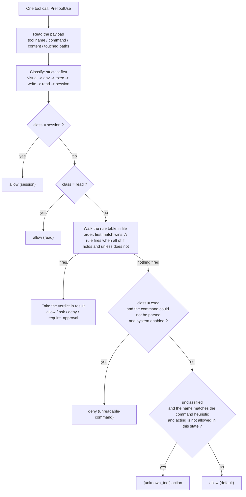

# OCF Policy Configuration Guide

English | [Chinese](../../POLICY-GUIDE_CH.md)

---

## 1. Rule format

A rule is one `[[rule]]` block in `policy.toml`.

```toml
[[rule]]
id      = "no-prod-config"                    # the rule's label
enabled = "switch"                            # the enable control
kind    = "hard"                              # hard: the hook; soft: the standing guidance text
result  = "deny"                              # the verdict when it fires
message = "Production config belongs to the human; hand it over when done."   # the readable explanation
unless  = { computed = "control_plane" }      # the scenario it is bypassed in

[rule.if]
class        = "write"                        # the tool class it matches
path_matches = '^config/prod/'                # a condition this rule owns: a path regex
```

### Fields

| Field       | Required  | Meaning                                                                                           |
| ----------- | --------- | ------------------------------------------------------------------------------------------------- |
| `id`        | yes       | The rule's identifier                                                                             |
| `enabled`   | no        | Three spellings, see below                                                                        |
| `budget`    | no        | A counting rule's own number. `failure-budget` reads it; the rule and its limit stay in one place |
| `kind`      | no        | `hard` (the default) or `soft`                                                                    |
| `label`     | soft only | The short name used when it is listed in the standing contract and in the reference region        |
| `[rule.if]` | **yes**   | The condition table that fires it                                                                 |
| `unless`    | no        | The exception. A condition table for a hard rule; for a soft rule a described scenario            |
| `result`    | hard only | Required for a hard rule: the verdict - `allow` / `ask` / `deny` / `require_approval`             |
| `else`      | no        | Soft only, optional: the text injected while it is off                                            |
| `message`   | yes       | Handed back by the hook, or injected into the guidance text, for the agent                        |

### The values `enabled` accepts

| Spelling   | Meaning                   |
| ---------- | ------------------------- |
| `true`     | Always on                 |
| `false`    | Always off                |
| `"switch"` | Follows the master switch |

### Conditions (the keys of `[rule.if]`)

Each key is one condition; its value is what it compares against.

| Condition                              | What it compares                                                                                                                                                                                                                                                                                         |
| -------------------------------------- | -------------------------------------------------------------------------------------------------------------------------------------------------------------------------------------------------------------------------------------------------------------------------------------------------------- |
| `class`                                | The tool class: `visual` / `env` / `exec` / `write` / `read` / `session` / `unknown`, or `any`                                                                                                                                                                                                           |
| `occasion`                             | The occasion a rule is for. For a **hard** rule the state: `ready` / `asking` / `planning` / `executing` / `reporting` / `blocked`. For a **soft** rule the moment: `session-start` / `ask` / `plan` / `act` / `answer` / `on-mistake`. One key, two sets of values - the `kind` decides which are legal |
| `tool`                                 | The tool name as the editor reports it                                                                                                                                                                                                                                                                   |
| `command_matches`                      | Regex against the command string                                                                                                                                                                                                                                                                         |
| `command_length_over`                  | Ceiling on the command's length                                                                                                                                                                                                                                                                          |
| `command_statements_over`              | Ceiling on the number of statements                                                                                                                                                                                                                                                                      |
| `command_repeats_at_least`             | How many times this exact command has already run                                                                                                                                                                                                                                                        |
| `content_matches`                      | What would be written, plus the raw tool input                                                                                                                                                                                                                                                           |
| `environment_declared`                 | Whether the human has declared the existing environment                                                                                                                                                                                                                                                  |
| `approval`                             | Approval is still required                                                                                                                                                                                                                                                                               |
| `computed`                             | A flag computed from the command, see below                                                                                                                                                                                                                                                              |
| `fact` with `is` / `is_not` / `is_set` | A fact recorded by the human or the hook: equals / does not equal / non-empty                                                                                                                                                                                                                            |
| `write_target_unread`                  | The call writes, but **where it writes could not be read**                                                                                                                                                                                                                                               |
| `path_matches`                         | A path regex, matched against the paths this call touches                                                                                                                                                                                                                                                |
| `touches_protected`                    | Whether each path this call would change is on the protected list                                                                                                                                                                                                                                        |

### Flags (`computed`)

| Flag              | True when                                                                                                                                      |
| ----------------- | ---------------------------------------------------------------------------------------------------------------------------------------------- |
| `control_plane`   | **Every** statement invokes the entry script by its full relative path. Reading the state is not acting, so it must not be held up by approval |
| `invokes_entry`   | At least one statement invokes the entry script                                                                                                |
| `human_only_call` | The entry script is invoked with a **human-only subcommand** as its argument                                                                   |

### The four values of `result`

| Value              | Effect                     |
| ------------------ | -------------------------- |
| `allow`            | Let it through             |
| `ask`              | Ask                        |
| `deny`             | Refuse, and say why        |
| `require_approval` | Refuse, and request review |

---

## 2. How a rule is hit



### Rule behavior notes

| Rule or behavior        | Operational meaning                                                                                                                                                                                                                                                                                                                                            |
| ----------------------- | -------------------------------------------------------------------------------------------------------------------------------------------------------------------------------------------------------------------------------------------------------------------------------------------------------------------------------------------------------------- |
| `p0-is-an-audit-result` | The agent cannot set `p0_count` with `set`. After `runSubagent` returns, the hook reads the `## P0 (N)` heading from the report and records the count. If the report has no such heading, the fact is cleared. This is report provenance, not proof of who authored the text.                                                                                  |
| `unread-write-target`   | The exec write scan is heuristic. If it detects a write but cannot recover a target path, path and protected-list checks cannot validate the destination, so the rule denies it while active. Use a file-editing tool or make the destination explicit.                                                                                                        |
| `touches-protected`     | The same rule covers `write` and `exec` calls and checks each recovered destination against `.github/protected.txt`. It is not a second tool-specific write rule. An unreadable destination is handled separately by `unread-write-target`.                                                                                                                    |
| Approval rules          | Specific deny/allow rules precede the generic `approval-required-*` rules because evaluation stops at the first match. `approval = true` means approval is required in the current state. `approval-required-exec` exempts only commands where every statement invokes the entry script by its full relative path; mixed commands are not control-plane calls. |
| Soft rules              | Soft-rule order does not decide a verdict. The hook injects the text whose `occasion` applies to the current event/state. After changing soft-rule text or rule data, run `reload` to regenerate the injected contract and reference documentation.                                                                                                            |

---

## 3. How to configure

| What you want                                  | Where to change it                | `reload`? | Window reload? |
| ---------------------------------------------- | --------------------------------- | --------- | -------------- |
| Add or change a gate rule                      | `[[rule]]` in `policy.toml`       | **yes**   | no             |
| Change a threshold                             | the number inside that rule       | no        | no             |
| Stop a tool being blocked                      | the relevant list under `[tools]` | no        | no             |
| Reword a soft rule                             | that rule's `message` text        | **yes**   | no             |
| Turn a rule off                                | its own `enabled` line            | no        | no             |
| Master switch off (`[system] enabled = false`) | `[system] enabled`                | no        | no             |
| Change which hook events are installed         | the `[hooks]` switches            | **yes**   | **yes**        |
| Add a self-check probe                         | `[selftest.canary]`               | no        | no             |
| Check whether the hook is running              | run `.github/ocf/liveness.py`     | no        | no             |

> [!INFO]
> A hard rule change takes effect immediately, but the documents do not follow.
> Use `reload` to rebuild the hard-rule documentation and the soft-rule injected text.
> Only `[hooks]` needs a window reload.

### Recipe 1: add a prohibition

```toml
[[rule]]
id      = "no-prod-config"
enabled = "switch"
result  = "deny"
message = "Production config belongs to the human; hand it over when done."

[rule.if]
class        = "write"
path_matches = '^config/prod/'
```

To beat an approval rule, put it **before** any `approval-required-*`.

### Recipe 2: add a tool

Add it to the matching list under `[tools]`.

- A tool listed in two classes is judged by the **stricter** one (`visual` is first).
- An unregistered tool that carries a command is judged as a command class; one that only carries a path falls to the command-class name heuristic.
- If its payload field is not the default `command` / `code`, add a field path under `[tools.field]`.

### Recipe 3: change a threshold

A threshold is **a number written inside the rule that uses it**, in that rule's `[rule.if]`. No `reload` needed.

### Recipe 4: turn a rule off

Set that rule's `enabled` to `false`.

### Recipe 5: add a soft rule

```toml
[[rule]]
id      = "my-discipline"
kind    = "soft"
label   = "short name"
enabled = "switch"
message = """
The sentence injected while it is ON."""
else    = """
The sentence injected while it is OFF. Optional."""

[rule.if]
occasion = "ask"
```

### Recipe 6: add a self-check probe

Add one under `[selftest.canary]`. A canary must go through the **real hook entry point**, or it does not prove the gate is alive. The whole set must contain **at least one that must deny and one that must allow**.

## 4. Related files and entries

- **Field and predicate vocabulary**: section 6 below, rendered by `reload`
- **Gates, tool classes and the rule list**: `.github/work-control-flow.md`
- **The standing guidance injected on every turn**: `.github/copilot-instructions.md`
- **The structural check list**: `.github/ocf/tests/run.py`
- **Whether the hook is actually running**: `.github/ocf/liveness.py`
- **Project overview and the usage walkthrough**: [`README.md`](../../README.md)

## 5. What the policy file used to explain, section by section

`policy.toml` is data and nothing else. Every explanation that used to sit above a key lives here
instead, because a second copy inside the file is a copy that can disagree with this one, and no reader
holds two files in view at once. Nothing is left there that is not a setting: no comment above a key, no
header, and not the generated vocabulary either. A file whose content changes behaviour should hold
nothing that cannot change behaviour.

### The file as a whole

- Rules are evaluated in file order and the **first match wins**. Exemptions therefore come first,
  precise rules next, and broad catch-alls last.
- The vocabulary in section 6 is generated from the tables in `ocf.py`, and `reload` rewrites it. It was
  written by hand once, and it drifted: it went on offering `when` values the engine had stopped
  accepting, and following it made the evaluator raise, which the hook turns into a denial of everything.
  Do not edit it; edit the tables.

### `[system] enabled`

- The single switch for the whole gate. `false` means the human has handed control back: the approval
  requirement and the orchestrator self-protection are skipped, so gate code may be edited, and
  `PreToolUse` and `Stop` answer nothing at all rather than answering `allow` - which would suppress the
  editor's own approval prompt and leave you less protected than with no gate installed.

### `[paths]`

- The protected list is a **fixed file**, not a configured path: a list that can be pointed elsewhere is
  a list that can be pointed away. Its entries are the files the machine never modifies, and a comment
  inside it marks the ones that are human-written.

### `[hooks]`

- Which events the orchestrator is installed on. `reload` rewrites `.github/hooks/orchestrator.json` from
  these switches, so this is the whole of "install / uninstall": turning `enabled` off writes a wiring
  file with no hooks in it, and the editor then never starts this program - nothing is left behind to
  switch off later. Any change here needs a window reload, because hooks are read when the window starts.
- `PreToolUse` is the gate. Switching it off stops everything being refused; the rest only add context,
  and the last three only write the journal.
- Each event's name, accepted aliases, timeout and answer shape live in the `HOOK_EVENTS` table in
  `ocf.py`, because one event answering in another event's shape is silent in both directions.

### `[approval]`

- `allowed_states` are the states in which acting is allowed. Entering them is a human-only act.
- `min_reason_len` demands a real sentence, so an accidental or scripted call cannot approve a plan.

### `[unknown_tool]`

- Applied only outside `allowed_states`. The values are `allow` / `ask` / `deny`. `ask` is only as strong
  as the editor's own approval logic, so anything that must hold belongs behind `deny`.

### `[selftest]`

- A canary proves the gate is alive. Each case runs through the **real hook entry point**, so a gate that
  quietly stopped denying is caught instead of looking healthy.

### `[tools]`

- A tool's class says what it does, and the verdict follows from that. Nothing there touches the network
  or a file the gate cannot see, so a list edit is all a new tool needs.
- Order in the file does not matter; the order the **classes are consulted in** does, and it is strictest
  first, so a tool listed twice is judged by the more restrictive entry.
- `write` changes text: the target path and the content are inspected.
- `exec` carries a command string, which is inspected. `create_and_run_task` keeps its command at
  `task.command`, which `[tools.field]` knows about.
- `env` sets up or changes the toolchain and the environment. Gated by `undeclared-env-tool` first, then
  by approval; the exec-class counterpart is `undeclared-env-command`.
- `visual` reads an image or drives a browser. Refused unconditionally, in every state, never subject to
  approval. Everything from the playwright family belongs here: `evaluate` runs code in a page and its
  payload is not a shell command, so it used to sit under `exec` and slip past the command-text ban.
- `session` shapes the conversation and cannot touch the repository. Never gated - that is what the class
  means. Dispatching a subagent is not a way round the gate, because the subagent's own tool calls come
  back through it.
- `read` only reads. Never gated. This list is what keeps the strict fallback policy usable: a broken
  policy file must deny every change, but denying reading as well leaves the agent blind and unable to
  help find the typo. `visual` is consulted before this class on purpose, so `view_image` - which is also
  a kind of reading - stays refused.

### `[tools.field]`

- Where each tool keeps its payload. A dotted path descends into nested objects, which is what fixed the
  class of bug where a command hidden at `task.command` was never inspected.

### Notes attached to individual rules

- `plan-file-writable`: `plan.md` is the artifact the gate itself demands, so it must be writable before
  approval.
- `touches-protected`: the orchestrator's own files are named in `.github/protected.txt`, not here. One
  list, one place.
- Soft rules carry natural-language guidance; run `ocf.py reload` after changing their text.
- `plan-template` / `report-template`: split out of `plan-file`, which was off, injected nothing, and
  mixed two decisions in one switch.

## 6. Policy vocabulary

Every identifier `policy.toml` may use, and what it means. This region is rendered by `reload` from
the tables in `ocf.py`, so it cannot describe a key the engine does not read, or miss one it does.
Editing it is pointless: `reload` rewrites it, and the check that compares this guide to the
renderer fails first.

<!-- OCF:VOCABULARY:BEGIN -->

```text
Every identifier the policy file may use, and what it means.
Rendered by `python .github/ocf/ocf.py reload` from the tables in ocf.py, so it cannot
describe a key the engine does not read, or miss one it does.

[sections]
  system         enabled: the maintenance window. A rule says for itself whether the window reaches it - `enabled = true` holds whatever the window says, `false` is never evaluated, `"switch"` is suspended by it - and `status` prints the rules the window actually switched off, rather than a list written down here that nobody recomputes. The switch is the human's: no rule grants the agent a way to reach it. The window itself takes only true or false; any other value is read as true and reported
  paths          state_dir: where the runtime lives. Everything else is a fixed filename, not a setting
  approval       allowed_states: the states acting is allowed in. min_reason_len: shortest approve reason
  hooks          which events the orchestrator is installed on; reload rewrites the wiring from these
  unknown_tool   action: verdict for an unrecognised tool that looks like it acts
  tools          the tool classes, and the payload field each tool keeps its command in
  selftest       canaries: one must deny and one must allow, or the gate is not proven alive
  rule           the rules themselves, evaluated in file order, first match wins

[rule] fields:
  id             the name every verdict carries, so a decision can be traced back to its rule. The tests assert these, so renaming one fails instead of drifting
  enabled        true: not subject to the master switch, so only a human editing this file can suspend it. "switch" or absent: the maintenance window suspends it. false: never evaluated. Any other value is read as true and reported
  budget         the rule's own number, for a rule that counts: `failure-budget` reads it as the number of consecutive failures before exec-class tools lock. It lives on the rule rather than in a shared table, so the rule and its own limit cannot drift into two files
  kind           hard: the hook reads it and gives a verdict. soft: reload writes it into the contract
  label          the short name a soft rule is listed under, in the generated contract and in the reference region
  if             the conditions that must all hold. This is the whole of a rule's logic
  unless         the exception. For a hard rule a condition table; for a soft rule a sentence the model applies
  result         hard only: allow | ask | deny | require_approval. A soft rule gives no verdict, so it does not use this key
  else           soft only: the sentence to inject while the rule is off. Optional - with no else, an off rule says nothing, which is what an off rule used to do unconditionally. It is how one rule carries both halves of a choice, the behaviour the human wants while it is on and the behaviour they want while it is off, so that neither half has to be copied into an agent or prompt definition, where no switch reaches it
  message        the sentence the agent reads. For a hard rule it is handed back inside the verdict, so write what to fix rather than what went wrong; for a soft rule it is the paragraph injected into the standing contract while the rule is on

[rule.if] conditions. Each key is one condition; the value is what it compares against,
which is usually a regex or a number.
  class                  the tool's class, or the class a tool carrying a command is judged as: visual, env, exec, write, read, session, unknown, or any for every tool
  occasion               the occasion a rule is for. One key, two sets of values: a hard rule names the states (ready, asking, planning, executing, reporting, blocked), a soft rule names the moments in the conversation (session-start, ask, plan, act, answer, on-mistake). The kind decides which are legal, and naming a value from the other set is reported rather than silently never firing
  tool                   the tool name as the editor reports it
  command_matches        regex against the command string
  command_length_over    the command is longer than this many characters
  command_statements_over the command has more statements than this, counted with quotes blanked
  command_repeats_at_least this exact command has already run at least this many times
  content_matches        regex against what would be written, plus the raw tool input
  environment_declared   the human has declared the existing environment (the stack_env fact)
  approval               true when a human approve is still outstanding, i.e. the state is not an acting state
  computed               a flag computed from the command. See the list below
  fact                   a fact recorded by the human or the hook, compared with is / is_not / is_set
  is_set                 with fact: the fact is non-empty (true) or empty (false)
  is                     with fact: the fact equals this value
  is_not                 with fact: the fact does not equal this value
  write_target_unread    the action writes, but no path could be read out of it, so no path condition can judge it
  path_matches           regex against each path the action touches. Judged per path, never as a batch
  touches_protected      each path the action would change is on the protected list, judged per path

computed flags, named by the `computed` condition:
  control_plane      every statement runs the entry script by its full relative path, so reading the state is not acting and needs no approval
  invokes_entry      at least one statement does
  human_only_call    the entry script is invoked with a human-only subcommand as its argument

`result` accepts:
  allow              let it through
  ask                the editor asks the human once; a pre-approval may swallow this
  deny               refuse, and say why. Handled before any approval logic, so nothing auto-approves past it
  require_approval   refuse, and tell the agent to have the human run the approve command

the moments a soft rule may name in its occasion. A hard rule names a state in the same
key - one key, two sets of values, and the kind decides which are legal:
  session-start      a session begins
  ask                a human reply is being read
  plan               a plan is being written or audited
  act                a tool is about to be used
  answer             an answer is about to be written
  on-mistake         a command produced no progress, or failed

[hooks] switches:
  enabled            the master switch. false writes a wiring file with no hooks: nothing is installed. Any other value is read as true and reported
  session_start      run the self-check when a session begins
  subagent_start     hand the child agent its brief when a subagent starts
  user_prompt        advance the state machine and report it on each human message
  pre_tool_use       the gate. Switching it off stops everything being refused
  post_tool_use      warn when a command produced no progress
  subagent_stop      record what a subagent reported when it stops
  stop               refuse to let a round that has reported end without closing
  pre_compact        record that the conversation is about to be compacted
  session_end        record the end of a session
  error_occurred     record an error the agent hit
```

<!-- OCF:VOCABULARY:END -->
