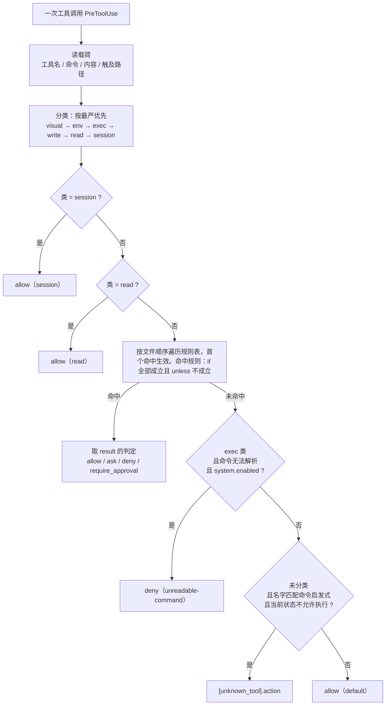

# OCF 策略配置指南

[English](.github/ocf/POLICY-GUIDE.md) | 中文

---

## 1. 规则格式

一条规则就是 `policy.toml` 里的一段 `[[rule]]`

```toml
[[rule]]
id      = "no-prod-config"                    # 规则标签
enabled = "switch"                            # 启用控制
kind    = "hard"                              # hard：hook；soft：常驻引导词
result  = "deny"                              # 命中结果
message = "生产配置是人类的，改完交给他"        # 可读解释
unless  = { computed = "control_plane" }      # 绕过情景

[rule.if]
class        = "write"                        # 匹配的工具类
path_matches = '^config/prod/'                # 本条规则独有的条件：匹配的路径正则
```

### 字段

| 字段        | 必填 | 含义                                                                    |
| ----------- | ---- | ----------------------------------------------------------------------- |
| `id`        | 是   | 规则标识                                                                |
| `enabled`   | 否   | 三种写法见下                                                            |
| `budget`    | 否   | 计数型规则自带的数字。`failure-budget` 读它；规则和它的上限只在一处     |
| `kind`      | 否   | `hard`（默认）或 `soft`                                                 |
| `label`     | 否   | 仅软规则必须。在常驻契约与参考区里列示时用的短名字                      |
| `[rule.if]` | 是   | 触发规则表                                                              |
| `unless`    | 否   | 绕过情景。硬规则为条件表；软规则描述绕过场景                            |
| `result`    | 否   | 仅硬规则必须。触发时的行为`allow` / `ask` / `deny` / `require_approval` |
| `else`      | 否   | 仅软规则可选。关闭时的注入内容                                          |
| `message`   | 是   | hook回传或引导词注入给agent的信息                                       |

### `enabled` 可用值

| 写法       | 含义       |
| ---------- | ---------- |
| `true`     | 总是开启   |
| `false`    | 总是禁用   |
| `"switch"` | 跟随主开关 |

### 条件（`[rule.if]` 的键）

每个键是一个条件，值是它要比较的东西

| 条件                                 | 比较对象                                                                                                                                                                                          |
| ------------------------------------ | ------------------------------------------------------------------------------------------------------------------------------------------------------------------------------------------------- |
| `class`                              | 触发工具分类：`visual` / `env` / `exec` / `write` / `read` / `session` / `unknown`，或 `any`                                                                                                      |
| `occasion`                           | 规则触发场合。硬规则可取状态：`ready` / `asking` / `planning` / `executing` / `reporting` / `blocked`；软规则自然语言描述时机：`session-start` / `ask` / `plan` / `act` / `answer` / `on-mistake` |
| `tool`                               | 编辑器报告的工具名                                                                                                                                                                                |
| `command_matches`                    | 命令串的正则                                                                                                                                                                                      |
| `command_length_over`                | 命令长度上限                                                                                                                                                                                      |
| `command_statements_over`            | 语句数上限                                                                                                                                                                                        |
| `command_repeats_at_least`           | 重复命令数量                                                                                                                                                                                      |
| `content_matches`                    | 即将写入的内容，外加原始工具输入                                                                                                                                                                  |
| `environment_declared`               | 要求声明环境                                                                                                                                                                                      |
| `approval`                           | 要求批准状态                                                                                                                                                                                      |
| `computed`                           | 从命令算出来的标志，见下                                                                                                                                                                          |
| `fact` ＋ `is` / `is_not` / `is_set` | 人类或 hook 记下的事实；比较值 / 不等 / 非空                                                                                                                                                      |
| `write_target_unread`                | 这次调用会写，但写到哪里读不出来                                                                                                                                                                  |
| `path_matches`                       | 路径正则匹配                                                                                                                                                                                      |
| `touches_protected`                  | 路径正则匹配保护文件清单                                                                                                                                                                          |

### 标志（`computed`）

| 标志              | 什么时候为真                                                                 |
| ----------------- | ---------------------------------------------------------------------------- |
| `control_plane`   | 每一条语句都按完整相对路径调用了入口脚本。读状态不算动手，所以不该被批准挡住 |
| `invokes_entry`   | 至少一条语句调用了入口脚本                                                   |
| `human_only_call` | 入口脚本后面跟的是**人类专属子命令**                                         |

### `result` 取值

| 取值               | 效果           |
| ------------------ | -------------- |
| `allow`            | 放行           |
| `ask`              | 询问           |
| `deny`             | 拒绝并说明原因 |
| `require_approval` | 拒绝并请求审查 |

---

## 2. 命中规则



### 规则行为说明

| 规则或行为              | 实际含义                                                                                                                                                                                                                                                 |
| ----------------------- | -------------------------------------------------------------------------------------------------------------------------------------------------------------------------------------------------------------------------------------------------------- |
| `p0-is-an-audit-result` | agent 不能用 `set` 写入 `p0_count`。`runSubagent` 返回后，hook 从报告的 `## P0 (N)` 标题读取计数并记录；报告没有该标题就清除此事实。这只能证明数值来自报告，不能证明报告作者身份。                                                                       |
| `unread-write-target`   | exec 写入扫描是启发式判断。它识别到写入却无法解析目标路径时，路径规则与保护清单无法核验目的地，因此规则启用时会拒绝。改用文件编辑工具，或让命令中的目标路径可读。                                                                                        |
| `touches-protected`     | 同一条规则覆盖 `write` 与 `exec` 调用，并逐个将解析出的目标路径和 `.github/protected.txt` 比较，不需要第二条按工具类别拆分的写入规则。目标不可读时由 `unread-write-target` 单独处理。                                                                    |
| 批准规则                | 特定 allow/deny 规则必须位于通用 `approval-required-*` 之前，因为规则按顺序检查且首个命中即结束。`approval = true` 表示当前状态确实要求批准。`approval-required-exec` 只豁免每条语句都通过完整相对路径调用入口脚本的命令；混合其他命令的调用不算控制面。 |
| 软规则                  | 软规则顺序不决定判定。hook 按当前事件/状态的 `occasion` 注入对应文字。改了软规则正文或规则数据后，运行 `reload` 重建常驻引导词与参考文档。                                                                                                               |

---

## 3. 如何配置

| 目标动作                                 | 相关文件                      | 执行`reload`命令 | 重载窗口 |
| ---------------------------------------- | ----------------------------- | ---------------- | -------- |
| 加／改一条门禁规则                       | `policy.toml` 的 `[[rule]]`   | √                | X        |
| 改一个阈值                               | 改那条规则里对应的数字        | X                | X        |
| 让某个工具不再被拦                       | 改`[tools]` 的对应列表        | X                | X        |
| 改一条软规则的措辞                       | 改该规则的`message` 文字      | √                | X        |
| 停用一条规则                             | 把它的`enabled` 改掉          | X                | X        |
| 总开关关闭（`[system] enabled = false`） | 改`[system] enabled`          | X                | X        |
| 换挂钩事件                               | 改`[hooks]` 各开关            | √                | √        |
| 查挂钩到底跑没跑                         | 运行`.github/ocf/liveness.py` | X                | X        |
| 加一条自检探针                           | 改`[selftest.canary]`         | X                | X        |

> [!INFO]
> 改硬规则立即生效但文档不会同步。
> 使用reload来重载硬规则文档和软规则注入词
> 改 `[hooks]` 才需要重载窗口

### 配方一：加一条禁止规则

```toml
[[rule]]
id      = "no-prod-config"
enabled = "switch"
result  = "deny"
message = "生产配置是人类的，改完交给他"

[rule.if]
class        = "write"
path_matches = '^config/prod/'
```

要压过批准规则，就放在任何 `approval-required-*` **之前**

### 配方二：加一个工具

加进 `[tools]` 里对应的类即可

- 一个工具同时出现在两类里时，由**更严**的那类判（`visual` 最先）。
- 没登记的工具带命令就按命令类判；只带路径就匹配命令类名字启发式。
- 它的载荷字段如果不是默认的 `command` / `code`，就到 `[tools.field]` 里补一条字段路径。

### 配方三：改一个阈值

阈值是**写在使用它的那条规则里的数字**，位于该规则的[rule.if]。改完不需要 `reload`。

### 配方四：停用一条规则

把该规则 `enabled` 改成 `false`

### 配方五：加一条软规则

```toml
[[rule]]
id      = "my-discipline"
kind    = "soft"
label   = "短名字"
enabled = "switch"
message = """
开启时注入的那句话。"""
else    = """
关闭时注入的那句话。可省。"""

[rule.if]
occasion = "ask"
```

### 配方六：加一条自检探针

在 `[selftest.canary]` 里加一条。金丝雀必须**走真实 hook 入口**，否则它证明不了门禁还活着。整套至少要有**一条必须 deny、一条必须 allow**

## 4. 关联文件与条目

- **字段与谓词词表**：`.github/ocf/POLICY-GUIDE.md` 第 6 节，由 `reload` 生成
- **门禁、工具分类与规则清单**：`.github/work-control-flow.md`
- **每次提问注入的常驻引导词**：`.github/copilot-instructions.md`
- **hook 到底有没有在跑**：`.github/ocf/liveness.py`
- **结构断言清单**：`.github/ocf/tests/run.py`
- **项目总览与使用流程**：[`README_CH.md`](README_CH.md)

## 5. 配置文件原先解释过的东西，逐段列出

`policy.toml` 是**数据**，再无别的。原先写在键上方的每一句解释，现在都在这里——因为留在文件里的第二份副本会与这一份分歧，而没有人能同时看着两个文件。文件里不再保留任何不是设置的东西：没有键上方的注释，没有表头，也没有生成词表——它在本文档第 6 节。内容会改变行为的文件，不该含有改变不了行为的东西。

### 整份文件

- 规则按**文件顺序**求值，**首个匹配即胜**。所以豁免在前、精确规则居中、宽泛兜底在最后。
- 第 6 节的词表由 `ocf.py` 里的表生成，`reload` 会重写它。它曾由手工维护并因此漂移：它继续提供引擎已不再接受的 `when` 取值，照着写会让求值器抛错，而 hook 把抛错变成拒绝一切。不要改它，去改表。

### `[system] enabled`

- 整个系统唯一的总开关。`false` 表示人类把控制权收回：审批要求与编排器自我保护都被跳过，所以门禁代码可以编辑；并且 `PreToolUse` 与 `Stop` **完全不回答**，而不是回答 `allow`——后者会压掉编辑器自己的审批提示，让你比"根本没装门"还危险。

### `[paths]`

- 保护清单是一份**固定文件**，不是可配置路径：能被指向别处的清单就能被指开。它的条目是机器永不修改的文件，其中的注释标出哪些是人类手写的。

### `[hooks]`

- 编排器装在哪些事件上。`reload` 依据这些开关重写 `.github/hooks/orchestrator.json`，所以这就是全部的"装/卸"：把 `enabled` 关掉会写出一个不含任何 hook 的接线文件，编辑器从此不再启动这个程序——不会留下任何东西需要事后关闭。改动这里需要重载窗口，因为 hook 是在窗口启动时读取的。
- `PreToolUse` 是门。关掉它就不再拒绝任何东西；其余事件只补充上下文，最后三个只写审计日志。
- 每个事件的名称、接受的别名、超时与**回答形状**都在 `ocf.py` 的 `HOOK_EVENTS` 表里——因为一个事件用另一个事件的形状回答，两个方向都是静默的。

### `[approval]`

- `allowed_states` 是允许动手的状态。进入这些状态是**人类专属动作**。
- `min_reason_len` 要求一句真话，使误触或脚本化的调用无法批准计划。

### `[unknown_tool]`

- 只在 `allowed_states` 之外适用。取值 `allow` / `ask` / `deny`。`ask` 只和编辑器自身的审批逻辑一样强，所以必须成立的东西要放在 `deny` 之后。

### `[selftest]`

- 金丝雀用来证明门还活着。每个用例走**真实 hook 入口**，所以一个悄悄不再拒绝的门会被抓住，而不是看起来健康。

### `[tools]`

- 工具的类别说明它做什么，裁决由此推出。这里没有任何东西会碰网络或门看不见的文件，所以新增工具只是改一个列表。
- 文件里的顺序无关紧要；**类别被咨询的顺序**才重要，它由最严格到最宽松，所以列进两个类别的工具按更严格的那个判定。
- `write` 修改文本：目标路径与内容都会被检查。
- `exec` 携带命令字符串，会被检查。`create_and_run_task` 把命令放在 `task.command`，下面的 `[tools.field]` 知道这件事。
- `env` 安装或改变工具链与环境。先被 `undeclared-env-tool` 拦，再走审批；`exec` 类的对应规则是 `undeclared-env-command`。
- `visual` 读图或驱动浏览器。在**任何状态**下无条件拒绝，永不走审批。playwright 一族全归这里：`evaluate` 在页面里执行代码，其载荷不是 shell 命令，所以它原先坐在 `exec` 下，能绕过命令文本禁令。
- `session` 塑造对话，碰不到仓库。永不被拦——这就是这个类别的含义。派发子代理不是绕过门的办法，因为子代理自己的工具调用也要经过门。
- `read` 只读。永不被拦。正是这个列表让"严格回退策略"仍然可用：坏的 policy 文件必须拒绝一切改动，但连读也拒绝会让 agent 瞎掉、无法帮你找出那个拼写错误。`visual` 故意先于本类别被咨询，所以 `view_image`——它也算一种读——保持被拒。

### `[tools.field]`

- 每个工具把载荷放在哪里。带点的路径会下钻到嵌套对象，这修掉了"藏在 `task.command` 里的命令从未被检查"那一类 bug。

### 挂在个别规则上的说明

- `plan-file-writable`：`plan.md` 是门自己要求的产物，所以必须在审批之前就可写。
- `touches-protected`：编排器自己的文件在 `.github/protected.txt` 里点名，不在这里。一份清单，一个地方。
- 软规则承载自然语言指引；改完它们的文字后跑 `ocf.py reload`。
- `plan-template` / `report-template`：从 `plan-file` 拆出——那条规则是关的、什么都不注入，还把两个决定混在一个开关里。

## 6. 词表

策略文件可用的全部标识符及其含义，见英文版 [`.github/ocf/POLICY-GUIDE.md`](.github/ocf/POLICY-GUIDE.md)
第 6 节。该节由 `reload` 从 `ocf.py` 里的表生成并重写，因此这里不再抄一份——第二份副本只会与第一份分歧。
